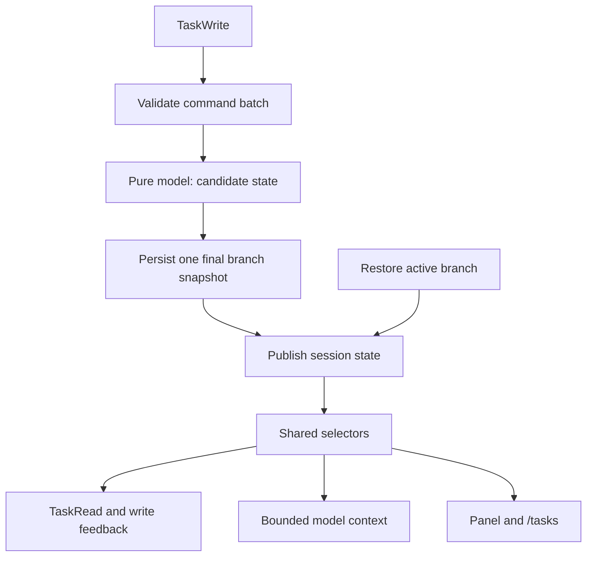

# A coherent task system for model workflows

Status: accepted design, implemented locally. See [validation](validation.md) for
executed checks and the live-provider evaluation that remains unexecuted.
Baseline: `1dae76e8102e7e75ba141163595b9cf3e7630fbd`.

## Decision

Build one session-local task system with a single authoritative state, atomic
batched changes, and derived views for the model and the human interface.

Use two model tools: `TaskRead` and `TaskWrite`. A single operation and a batch use
the same write contract. Requirements and latest progress belong to the same task
record. Dependency relationships have one stored representation. Tool feedback,
model context, and the panel use the same selectors. Branch snapshots are the
only durable task store.

Claude Code and other todos supply evidence and ideas, not additional execution
modes. Do not preserve the four-tool facade merely for familiarity, and do not add
a fifth batch tool beside it. The cost of this decision is a deliberate public API
replacement; the benefit is one mutation contract for creation, progress, plan
changes, completion, and deletion.

Implementation is authorized. Publication and changes to existing session files
are outside this work.

## Job and evidence

The system helps a model remember unfinished commitments, revise them when facts
change, and continue after context loss with little bookkeeping. The panel lets
a human inspect the same commitments. Task maintenance is useful only when it
improves completion or continuity.

The preceding investigation structurally scanned 161 sessions in 26 allowlisted
projects and examined relevant call sequences in eight sessions. The explicitly
excluded project, its descendants, and its corresponding session files were not
opened. General-purpose working directories and temporary test sessions were not
sampled. Raw transcripts and private paths are not included here.

| Observation | Design implication |
| --- | --- |
| Serial task calls were incorrectly reported as batched in the pi-todos session starting 2026-10-11. Later sessions do use the dispatcher successfully. | Put multi-operation changes inside the tool contract; verify actual request behavior rather than assistant claims. |
| A pi-hashline-edit session starting 2026-10-10 contains 82 reminders, 11 on branches whose latest task snapshot is empty. | Replace the timer-driven reminder stream with a bounded view of actual unfinished work. |
| Task 13 in the pi-hashline-edit session starting 2026-10-11 at 08:55 UTC had its requirements description replaced by execution progress. | Give requirements and the latest checkpoint distinct fields. The overwrite is observed; resulting missed requirements are not proven. |
| An unknown-ID update in the codex session starting 2026-10-10 returned `Task not found`, followed by a separate List call revealing an empty list. | Make mutation failures explain unchanged state and provide bounded recovery information. The cause of the wrong ID is unknown. |
| An older pi-provider-zcode session reassigned task 51's dependency from 50 to 49, then removed task 50. | Dependencies must be editable without deleting and recreating the dependent task. |

Separate old `todo` interfaces, current `Task*` interfaces, and intentional tool
tests when evaluating these observations. Session assistant-message counts are a
proxy, not exact HTTP-request or billing counts.

## Why this architecture

| Candidate | Change cost | Ongoing caller knowledge | Decision |
| --- | --- | --- | --- |
| Keep four tools and add array arguments to Create and Update | Lowest call-site change cost | Two mutation shapes; mixed create/update still requires composing calls; four descriptions | Not selected. It preserves a boundary that no longer matches the caller's job. |
| One `todo` tool with every action and optional argument | One tool name | Read filters, single writes, and batches coexist in a broad action schema | Not selected. Tool count alone does not make the contract simpler. |
| One read tool and one atomic write tool | Replace names, schemas, and consumers together | Read current state or submit an ordered set of changes | Selected. Mixed plan changes use one path and one result. |

This does not require a framework or a new module hierarchy. Extend the existing
pure model, store, persistence, formatting, and Pi integration owners. Remove
superseded paths in the same milestone that replaces them.



Only the write path or branch restoration replaces live state. Reads, context
assembly, and rendering never mutate it.

## One task model

Retain numeric-string IDs and the statuses `pending`, `in_progress`, and
`completed`. Completion is reversible. Multiple tasks may be in progress; a
single meaningful task is valid. Dependency information does not automatically
start, complete, or reject starting a task.

| Stored field | Meaning and update rule |
| --- | --- |
| `id` | Assigned by the store; stable within branch history and never reused after deletion. |
| `subject` | Short statement of the outcome. |
| `description` | Current requirements, constraints, and completion criteria. Explicitly editable when requirements change. |
| `progress` | Optional latest checkpoint: useful findings, remaining work, and next action. Replaced, not appended. |
| `status` | Current execution state; only the caller determines whether completion criteria were met. |
| `dependsOn` | IDs of prerequisite tasks, stored once on the dependent task. Replacing the array revises dependencies; `[]` removes them. |
| `owner` | Optional assignment label, not a claim, lock, or subagent identifier with runtime authority. |
| `activeForm` | Optional presentation text; never necessary to make progress. |
| `metadata` | Optional caller data. Readable through task details, not a bag for hidden domain rules. |

All updates follow one rule: omitted fields are unchanged; supplied values replace
the field; `null` clears an optional field. Arrays and metadata are whole-field
replacements, not a second merge language. Required strings cannot be cleared.
Do not introduce separate add/remove dependency commands or metadata-key patch
semantics. A model changing only status sends only status.

Derive reverse dependents and current blockers from `dependsOn`. Use `blockedBy`
only for prerequisites that are still unfinished. Every model and human view uses
that same meaning; task details also expose the complete `dependsOn` relation.
Reject missing prerequisite IDs, self-dependencies, and cycles in the final
candidate graph. Reopening a prerequisite makes it a current blocker again but
does not silently reopen completed dependent tasks.

Deletion is an explicit command, not a status. It removes a task and references
to it; it does not assert that the deleted work was completed. No cancellation
status or tombstone ledger is added in this scope.

There are no hidden live tasks in the target model. Metadata keys, including
`_internal`, are ordinary caller data with no visibility semantics. No metadata
key can make unfinished commitments disappear from model state, completion
checks, or human inspection.

## One read contract and one write contract

### TaskWrite

Always accept an `operations` array, including for one operation. Use typed
`create`, `update`, and `delete` variants. Create and update share the same field
names and value semantics; update uses `set` to distinguish task identity from
changed fields. Reject fields belonging to another operation variant.

```json
{
  "operations": [
    { "action": "update", "id": "1", "set": { "status": "completed", "progress": "Regression reproduced before the fix and passes now" } },
    { "action": "update", "id": "2", "set": { "status": "pending" } },
    { "action": "create", "task": { "subject": "Investigate the new failure", "description": "Identify the cause before resuming task 2", "status": "in_progress" } }
  ]
}
```

The example completes work, re-queues another task, and creates an interruption in
one call. Ordinary initial planning uses several create operations; finishing and
starting known tasks uses two update operations. The caller never resends the
whole plan just to change one status.

Validate the external shape once, then apply typed operations to an unpublished
candidate in order. Check final-state invariants before committing. Unknown IDs,
invalid field values, or an invalid final graph reject the entire batch. A batch
that deletes a task and later updates that ID fails without changing live state.
ID allocation in a rejected batch is not committed.

Persist one final custom snapshot before publishing live state. Preserve the
existing Pi session-manager durability boundary; this is not an exactly-once
transaction across network retries. A wholly unchanged batch returns a no-op and
does not append another snapshot. Keep state evaluation and publication
serialized per session, including nested codemode calls.

Return compact per-operation outcomes with IDs in input order. Compute next-ready
and active-task hints from the final state. Do not echo unchanged descriptions or
return an intermediate next-task suggestion that the same batch has already
started. Text and `structuredContent` are representations of one typed outcome.

Use one error shape containing code, operation index when applicable, field,
requested ID when applicable, and a message stating what remained unchanged.
Unknown-ID failures include an explicit empty-plan result or a bounded active-task
summary and a route to further details. Never guess the intended task ID.

IDs referenced by a request must already exist before that request. Newly created
tasks return their IDs; dependencies between them can be set in the next call.
No predicted IDs, temporary aliases, nested batches, or expression references.

### TaskRead

Provide two explicit query variants:

```json
{ "view": "summary", "scope": "active" }
```

```json
{ "view": "details", "ids": ["1", "2"] }
```

Summary is the default, with active scope by default. An explicit `scope: "all"`
includes retained completed work. Summary pages use creation-ID order and an
`afterId` continuation, returning `nextAfterId` and total/omitted counts. Full
inspection uses selected IDs and returns all stored fields with derived blockers;
unknown selected IDs use the same not-found error vocabulary as writes. Invalid
combinations of query arguments are rejected, not silently ignored.

Define bounds for operations, selected IDs, input fields, and view output in one
schema/policy owner. Derive types, parameter descriptions, and validation from
those definitions. The implementation defines concrete limits in `src/schema.ts`, documented in
[tool bounds](tool-schema.md#bounds). Do not scatter unrelated magic numbers or
expose tuning knobs without a demonstrated user need. Views must disclose truncation and provide
bounded continuation rather than truncate stored data.

## One state, multiple views

The domain selectors determine visibility, dependencies, counts, and ready tasks.
Formatting determines text length and terminal styling. Neither layer redefines
what completion or blocking means. Different surfaces can show different detail
budgets without reporting different task facts.

Use the existing `context` hook to derive one bounded active-task view for each
provider request when task context is enabled. Prioritize requirements and latest
progress for in-progress tasks, then pending-task summaries. Include omissions
and a detail-query route. Quote task data and retain the rule that current user
instructions take precedence. Do not inject completed history or arbitrary
metadata into the normal context view.

This view is transient and computed from current branch state. It is not another
persistent task store and does not accumulate in the transcript. A non-task tool
call, aborted response, or retry cannot acknowledge the view away; the next
request derives it again. No unfinished tasks means no injected task view.

Replace the separate one-shot resume tracker and every-ten-turn reminder with
this policy. Do not retain both policies behind modes. Context supplies current
facts; concise tool guidance explains how to act on them. There is no generic
nag to create tasks, no synthetic model request, and no timer stream of reminders.

The trade-off is recurring context input. Keep the view bounded and measure its
input/cache-read cost against the baseline. Do not promise better prompt caching.
The proposal must pass a two-request recovery probe and a long-task cost
comparison before release. If it fails the cost/continuity target, revisit this
single policy rather than layering the old reminders back on top.

Completed tasks stay in state and remain readable and reopenable. The panel hides
completed-only plans by default; `/tasks` and explicit all-scope queries still
expose them. Starting a new run or creating new tasks does not clear prior state.
Deletion remains explicit. No archive database or automatic cycle rollover.

## Persistence and configuration: no backward compatibility

Use full branch snapshots with one new format version and one reader/writer for
that version. Restore the current branch using only the new contract. Reject an
unsupported or malformed task snapshot with a clear error; do not convert it,
skip it to restore stale state, or treat it as an empty plan. No snapshot means
an empty plan. These format checks do not require an old-format decoder.

Preserve existing session files without rewriting or deleting them. Start using
the replacement with a new session and configuration conforming to the new schema.
Restoring old task state, importing old tasks, downgrade support, and rendering
old tool results through new compatibility handlers are outside the contract.
IDs and their allocation high-water mark remain durable within new-format branch
history. Test new-format restoration, branching, and wrapped writes.

Use only `taskContext` for task context policy. Remove `resumeContext`,
`taskReminder`, and the four old per-tool guidance slots. Expose guidance for
TaskRead and TaskWrite only. Reject removed or unknown configuration fields at
the configuration boundary; do not translate, ignore, merge, or fall back from
them. Error messages identify the invalid field. Do not rewrite user config.

Register only TaskRead and TaskWrite. Accept only their new schemas: no old tool
aliases, alternative argument shapes, numeric-ID coercion, argument repair, or
legacy result adapters. Update tool allowlists, codemode consumers, examples,
renderers, tests, README, configuration/overlay/development docs, and CHANGELOG
to the same contract. Remove replaced code paths rather than retaining shims.

Backward compatibility is excluded during implementation as well as at release.
Tests for unsupported data verify rejection and that existing files stay intact;
they must not require conversion, successful restoration, or historical rendering.

## Implementation sequence

| Milestone | Work and owner | Required evidence |
| --- | --- | --- |
| M0: Baseline fixtures | Capture small synthetic equivalents of the observed workflows and request-level recovery/cost probes. Record the checkout and loaded host separately. | Distinguish actual requests, persisted assistant messages, tool tests, and ordinary work. No private transcript is committed. |
| M1: Replace the task contract | Replace the model, two public tools, batch commit path, snapshot format, configuration schema, and all affected consumers together. Use requirements/progress, one dependency representation, bounded queries, and shared selectors. Remove old tools, readers, argument repair, settings, reminder/resume machinery, and automatic clearing. | Mixed writes use one call; middle failure publishes nothing; storage failure leaves live state unchanged; no-op writes save nothing; progress preserves requirements; dependency revision and reopening are consistent; unsupported data/config is rejected without modification; new snapshots restore across branch navigation and codemode calls. |
| M2: Complete shared views | Derive bounded current-state context, tool feedback, panel, and command views from the canonical selectors, with matching guidance and renderers. | Task information survives a non-task tool round trip; empty/completed state injects nothing; no reminder accumulation; completed work reopens; headless and child sessions remain isolated; retained tasks are discoverable through bounded reads. |
| M3: Integration and behavior evaluation | Complete contract documentation and breaking-change notes; run fixed scenarios and compare cost/correctness; audit for duplicated policy and obsolete paths. | All affected checks pass; the two-tool schema works on the intended host/model; measured request/cost outcomes and limitations are reported; no task-correctness regression within the new contract. |

These are development checkpoints within one replacement, not separately shipped
feature packages. Complete the new contract before release. If a checkpoint split
would require a compatibility adapter, combine the affected work instead. Update
tests and affected documentation with each change; never ship an intermediate
state with missing views or inaccurate instructions.

## Validation and architectural acceptance

Use [the development checks](development.md): affected unit and integration tests
per milestone, then `npm run check`, `npm test`, package dry-run, and
`git diff --check` at final integration. Verify the pinned development host and
the intended installed host separately. A passing Pi 0.99.2 suite does not certify
a newer host or its model-schema translation. Isolate HOME, USERPROFILE, XDG
configuration, and session directories for executable fixtures.

The fixed behavior set covers initial planning, mixed completion/start/create,
dependency revision, unknown-ID recovery, compaction followed by a non-task tool,
reopening completed work, long active work, empty plans, branch navigation, and
child-session isolation. Include an invalid middle operation, duplicate requests,
no-op updates, oversized input, and persistence failure. Verify rejection of old
snapshot versions, old tool/argument shapes, and removed configuration keys;
assert that rejected inputs neither change live state nor modify existing files.
Do not silently retry creates after an uncertain external outcome.

Compare baseline and candidate on a fixed host/provider/model with repeated
batching and recovery scenarios. Broaden to another model and a dispatcher-free
host before making portability claims. Keep this an opt-in local evaluation,
not runtime telemetry or a benchmark framework.

Record actual provider requests when observable; otherwise label message counts
as a proxy. Separate task-only requests from substantive work. Record prompt and
result sizes, input/cache-read usage where available, unnecessary reads, omitted
requirements, premature completion, and repeated investigation. Do not convert
cache-read totals directly into money saved. Unit tests prove contracts, not
model compliance.

Before release, answer these architecture checks:

- Is every task fact stored once and every mutation committed through one path?
- Do all readers agree on blockers, visibility, progress, and completion?
- Are text, structured results, and the panel derived from typed state/outcomes?
- Are old-format readers, tool aliases, argument repair, config conversion, and
  historical result adapters absent?
- Have old tools, reciprocal-edge mutation logic, hidden-task policy, resume
  acknowledgements, timed reminders, and run-start clearing been removed?
- Does each remaining option have one meaning across the whole system?

## How external ideas were absorbed

The sources below informed the design principles. They are not package
endorsements, code-copy instructions, or separate modes in the target system.
References pin repository revisions, not npm tarball contents.

| Source | Principle absorbed into this architecture |
| --- | --- |
| [`4fuu/pi-todo`, `state.ts`, `efabf560`](https://github.com/4fuu/pi-todo/blob/efabf5608fb68c0b6e94998132f0e5d16bdb43b4/src/state.ts) | Requirements and progress describe different facts. We store one editable requirements field and one replaceable checkpoint in the canonical task; we do not import its append-only progress events or terminal-state rules. |
| [`zhcsyncer/pi-extensions`, task reducer, `f48a91b8`](https://github.com/zhcsyncer/pi-extensions/blob/f48a91b8366174f2ece5d393e280641be87fbb70/packages/pi-todo/state/state-reducer.ts) | A plan change should commit completely or not at all. This becomes the only TaskWrite execution path, without its minimum-two-task and single-active-task restrictions. |
| [`zhcsyncer/pi-extensions`, tool guidance, same revision](https://github.com/zhcsyncer/pi-extensions/blob/f48a91b8366174f2ece5d393e280641be87fbb70/packages/pi-todo/todo.ts) | Active work deserves the default attention budget. Shared selectors apply this to reads, context, and UI while retaining completed tasks for reopening. |

The inspected zhcsyncer revision has no dependency fields; dependency revision is
supported by our own session evidence. Its broader architecture is not adopted.
The existing pi-todos pure model and branch snapshots already fit the selected
system and remain the implementation foundation.

## Non-goals

No shared task database, cross-session claims, subagent model routing, worker
scheduler, priorities, deadlines, progress journal, fixed minimum task count,
single-active-task restriction, automatic archival, event-sourcing rewrite,
backward compatibility, broad UI redesign, or new runtime dependency.
